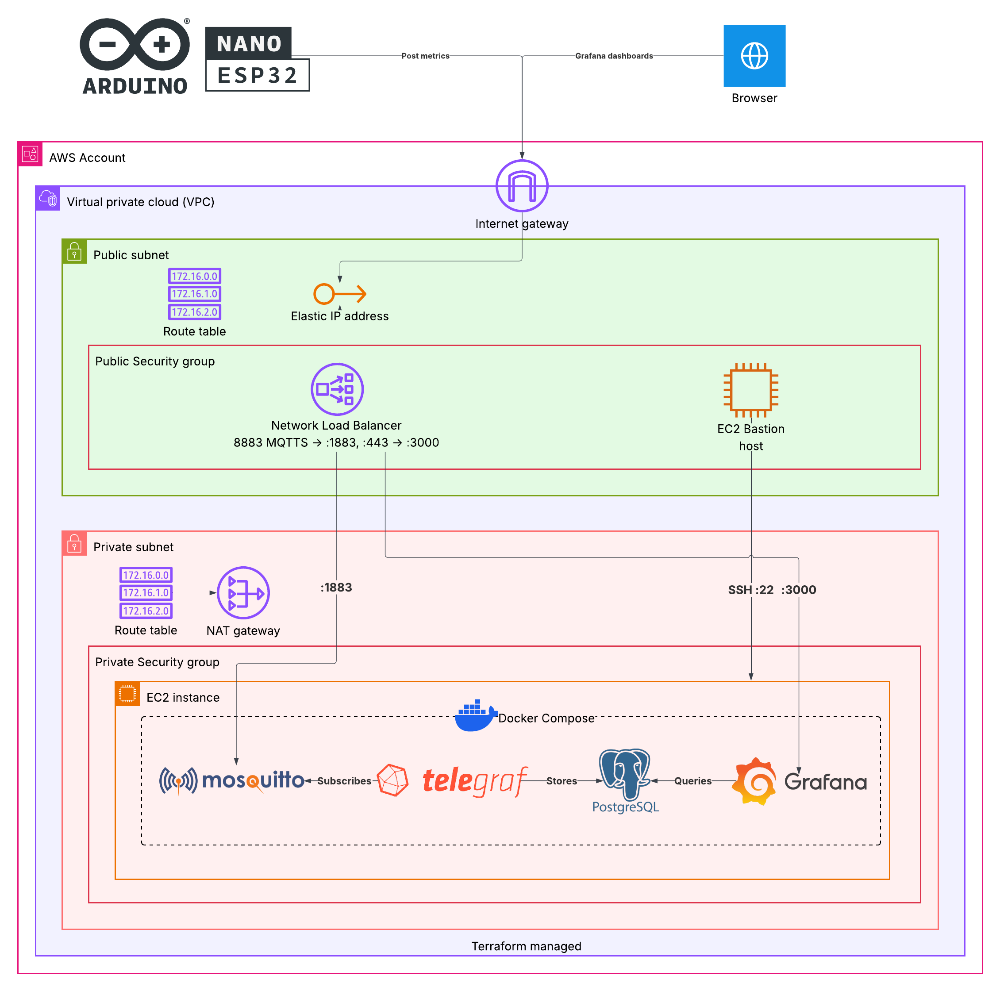
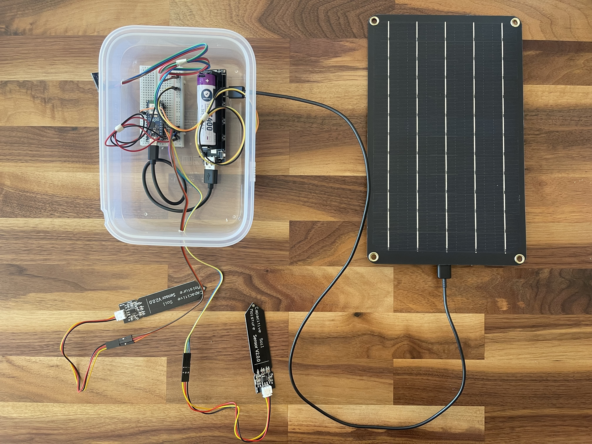
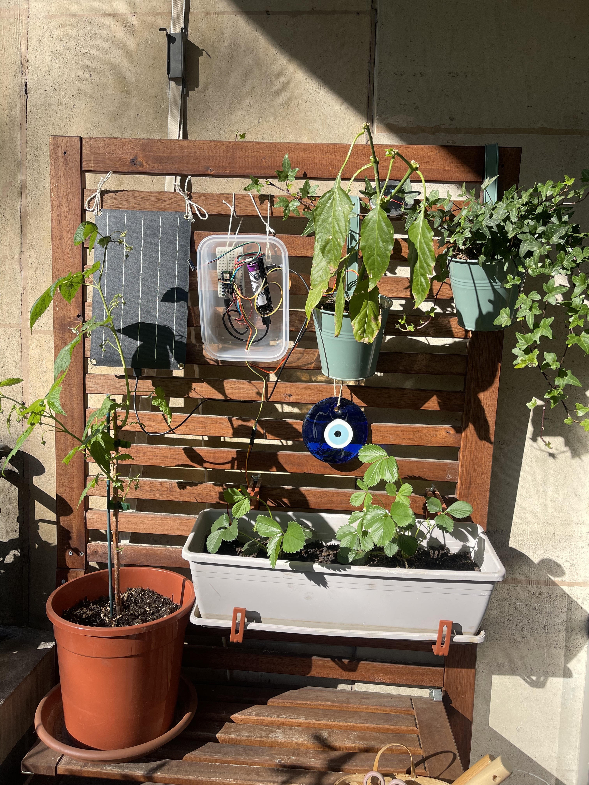

# Balcony Farm IoT Monitor

Real-time environmental monitoring system for balcony grown strawberries and chili peppers, built with ESP32, MQTT, and a full observability stack.

## What is this

An IoT data pipeline that reads temperature, humidity, soil moisture, and light intensity from live plants on a balcony, pushes data over MQTT and visualizes everything in Grafana with alerting.
Built as a hands-on learning project exploring Controlled Environment Agriculture (CEA), from a humble balcony garden.

## Objective

Collect data on the environmental conditions these plants are exposed, visualize it in metric dashboards, setup alerts for quick actions (water plants, move to shade during harsh summer sun, protect from cold, etc) and overall monitor plants to increase their yield. In other words, build a gardening assistant for my balcony plants.

## Architecture

Arduino ESP32 + Sensors -> WiFi -> Mosquitto (MQTT) -> Telegraf -> TimescaleDB -> Grafana

### Hardware

- Arduino ABX00083 Board Nano ESP32
- Purecrea BH1750 GY-302 Digital Light Sensor
- Purecrea DHT22 Temperature and Humidity Sensor
- 2x Purecrea Capacitive soil moisture sensor V1.2
- 10.000 mAh Battery 

Mistol_01 in all its glory with Ikea tupper cover case, it can be then hermetically sealed against weather and ants...

Balcony farm with Mistol_01 installed

### Software stack

- Firmware: PlatformIO + Arduino framework (C++)
- Broker: Eclipse Mosquitto (MQTT)
- Collector: Telegraf (MQTT consumer -> PostgreSQL output)
- Database: TimescaleDB (PostgreSQL + hypertables)
- Dashboard: Grafana (time series panels + alerting)
- Deployment: Docker Compose -> K3s (planned for lightweight kubernetes in small VM, just to be fancy)

## Roadmap

- Initial hardware assembly + sensor validation. Done.
- WiFi + MQTT publishing from ESP32. Done.
- Docker Compose stack (Mosquitto -> Telegraf -> TimescaleDB -> Grafana). Done.
- Grafana dashboards with per plant alert thresholds. In progress.
- GitHub Actions CI/CD (for Docker builds)
- IaC for cloud hosting Mosquitto (24/7 log capture). Done.
- TLS + auth for MQTT broker exposed to internet. Done.
- Migrate to K3s with Helm charts
- Feed battery with solar power
- Trigger automated watering for defined humidity thresholds
- Camera module to track plant growth progress
- More to add whenever I have more ideas
