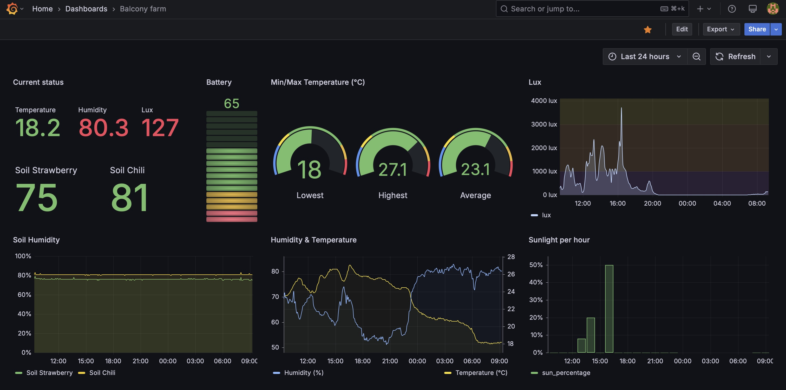
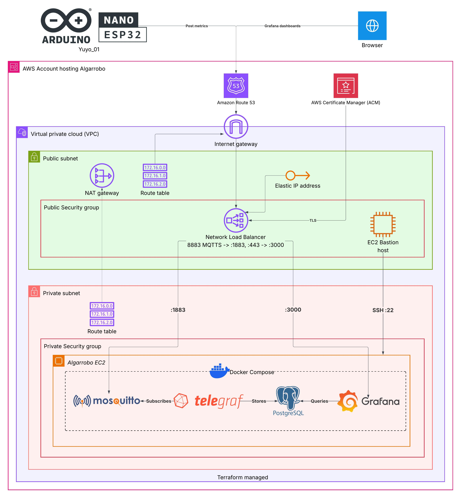
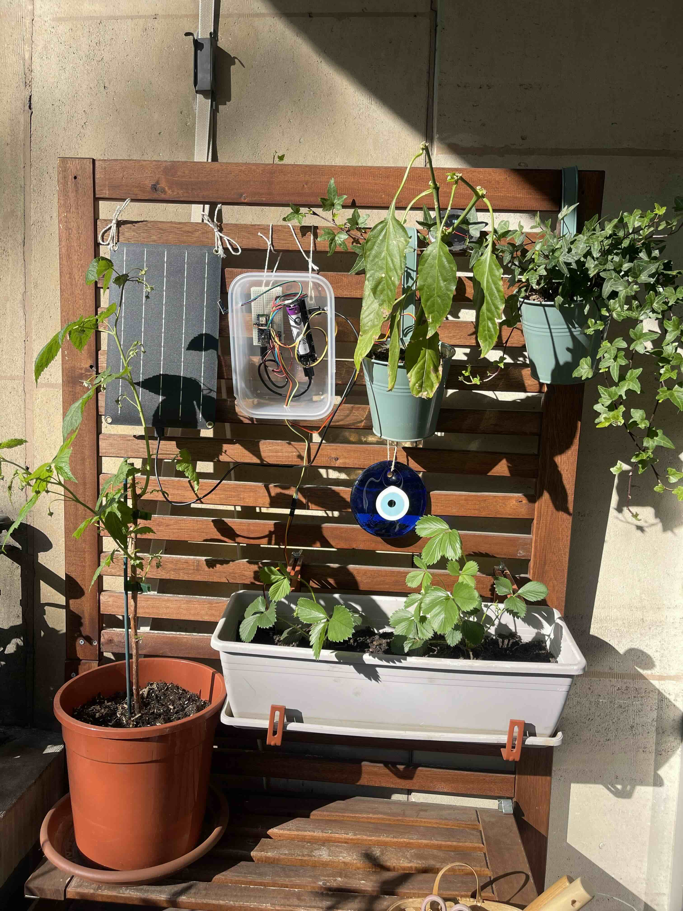
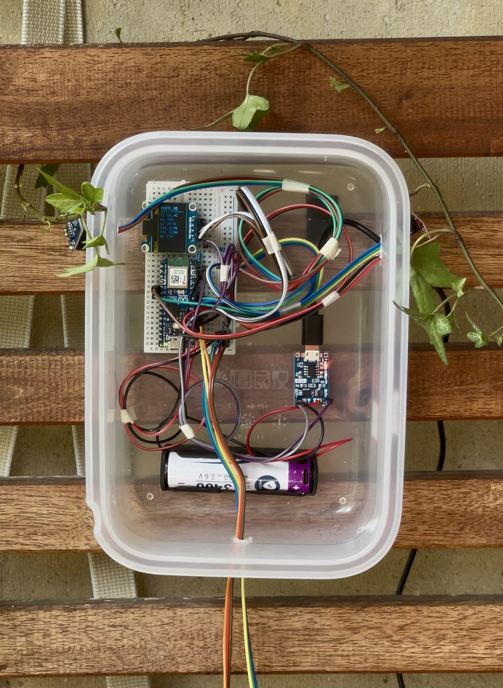

# Balcony Farm IoT Monitor

Real-time environmental monitoring system for balcony grown strawberries and chili peppers, built with ESP32, MQTT, and a full observability stack.

## What is this

An IoT data pipeline that reads temperature, humidity, soil moisture, and light intensity from live plants on a balcony, pushes telemetry data over MQTT and visualizes everything in Grafana with alerting.
Built as a hands-on learning project exploring Controlled Environment Agriculture (CEA), from a humble balcony garden.

## Objective

Collect data on the environmental conditions these plants are exposed, visualize it in metric dashboards, setup alerts for quick actions (water plants, move to shade during harsh summer sun, protect from cold, etc) and overall monitor plants to increase their yield. In other words, build a gardening assistant for my balcony plants.

### Visualization

Screenshot of current Grafana dashboard.

With the metrics pulled a lot of insights can be obtained. Like how humidity goes up at night and how it is proportionally inverse to temperature. Historics can show trends and off season changes. Maybe the real value is the data set itself. 

## Architecture

Arduino ESP32 + Sensors -> WiFi -> Mosquitto (MQTT) -> Telegraf -> TimescaleDB -> Grafana

### Hardware

Yuyo_01 in all its glory with Ikea tupper cover case, solar fed battery and OLED display to show current metrics. It can be then hermetically sealed against weather and ants... And the best thing, it's hands-free, once it has sunlight it'll just work.

Balcony farm with Yuyo_01 installed

Yuyo_01 device close-up and wiring

- Arduino ABX00083 Board Nano ESP32
- Purecrea BH1750 GY-302 Digital Light Sensor
- Purecrea DHT22 Temperature and Humidity Sensor
- 2x Purecrea Capacitive soil moisture sensor V1.2
- DFRobot Solarpanel 6W
- TC-13220688 Battery shield
- Purecrea TP4056 Lithium LiPo Battery Charger
- Ansmann Li-Ion battery 18650

### Software stack

- Firmware: PlatformIO + Arduino framework (C++)
- Broker: Eclipse Mosquitto (MQTT)
- Collector: Telegraf (MQTT consumer -> PostgreSQL output)
- Database: TimescaleDB (PostgreSQL + hypertables)
- Dashboard: Grafana (time series panels + alerting)
- Deployment: Docker Compose -> K3s (planned for lightweight kubernetes in small VM, just to be fancy)

## Roadmap

- Initial hardware assembly + sensor validation. Done.
- WiFi + MQTT publishing from ESP32. Done.
- Docker Compose stack (Mosquitto -> Telegraf -> TimescaleDB -> Grafana). Done.
- Grafana dashboards with per plant alert thresholds. Done.
- GitHub Actions CI/CD (for builds and tests) In progress.
- IaC for cloud hosting Mosquitto (24/7 log capture). Done.
- TLS + auth for MQTT broker exposed to internet. Done.
- Feed battery with solar power. Done.
- OLED Display showing current telemetry. Done.
- Migrate to K3s with Helm charts
- Trigger automated watering for defined humidity thresholds
- Camera module to track plant growth progress
- Expand metrics captured, like soil pH
- LLM integration to get insights on plants conditions.
- More to add whenever I have more ideas

## Design decisions

A few choices worth explaining:

NLB instead of ALB: Two reasons. First I decided to have a single entry point for both Yuyo_01 posting metrics and accessing the Grafana dashboard to keep the architecture simple. Then let the LB route traffic. Second, because MQTT is TCP native while ALBs only speak HTTP/HTTPS. NLBs handle raw TCP and can terminate TLS.

TimescaleDB instead of plain Postgres: Sensor data is heavily time-series. TimescaleDB's hypertables handle this with automatic partitioning and faster query speed compared to Postgres.

Private subnet + bastion host: No service runs in the public subnet. The NLB forwards traffic in. The bastion is the only way in for support.

enable_private_subnet flag in Terraform: I wanted to leave the choice to have a single VM without bastion or NLB, which is a working and cheaper solution but with the tradeoff of security for having it exposed to the internet. Showing how to host a service securely.

Modularization on Terraform: I made this structure so I can reuse parameterized resources/ from different modules/, now currently consumed by a single solution algarrobo/. But in the future they could be consumed by other solutions as well, without duplicating code and having certain default configurations. Think of it like templates.

## License & usage

The source is available for reading, learning, evaluating, and personal/educational use under the [PolyForm Noncommercial License](LICENSE).

I'm sharing this publicly because portfolio transparency matters and because I think the patterns here are interesting to discuss. 

Happy to chat about the design, answer questions, or hear feedback, just open an issue or reach out on LinkedIn!

Copyright © 2026 Valter Simes
